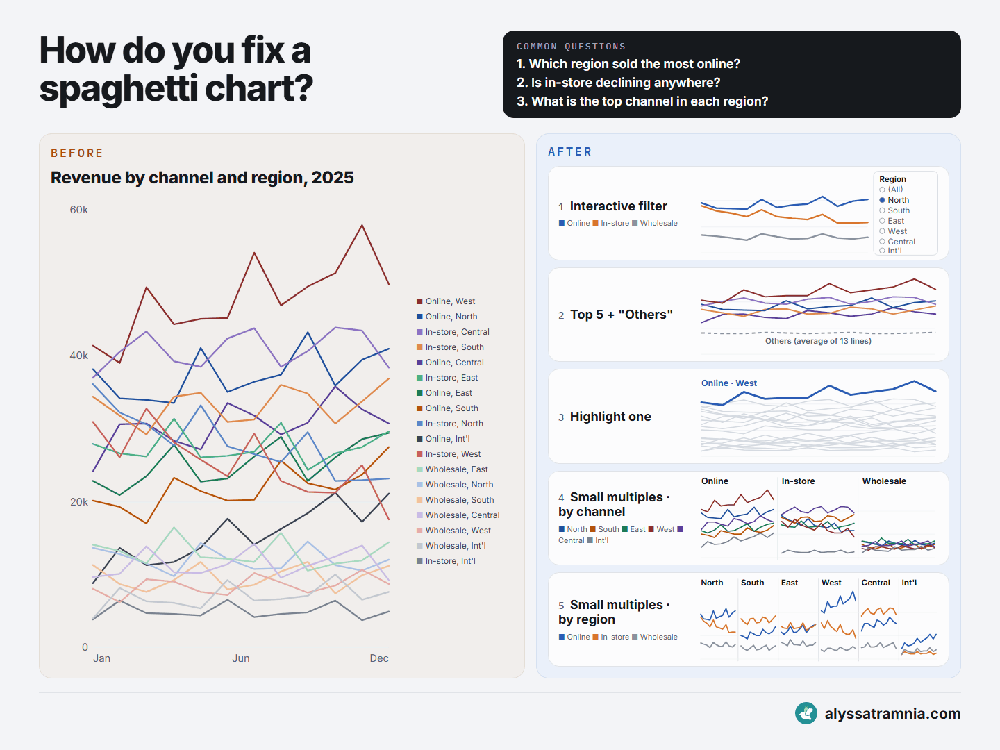

# 01 · How do you fix a spaghetti chart?

Revenue by channel and region: 3 channels × 6 regions = 18 lines on one chart. This Power BI file shows that chart and five ways to redraw it, so you can compare what each one reveals and what it hides.

| Page | What's on it |
|---|---|
| **Before** | The spaghetti chart: 18 lines, 18 legend entries |
| **5 ways to fix** | 1 Interactive filter · 2 Top N + "Others" · 3 Highlight one · 4 Small multiples by channel · 5 Small multiples by region |

The sample data is illustrative (generated, not real sales). You can swap in your own CSV in about five minutes without changing any visual.

## Open the sample

1. Download or clone this repository. You need Power BI Desktop (free, recent version).
2. Open `01-spaghetti-chart/spaghetti-chart.pbip`.
3. Go to **Home → Transform data → Edit parameters** and set **DataFolder** to the full path of the `data` folder, ending with `\`, e.g. `C:\Downloads\powerbi-best-practices\01-spaghetti-chart\data\`.
4. Click **Refresh**.

## Use your own data

Your CSV needs four columns (any header names):

| Column | Example | Becomes |
|---|---|---|
| A date | `2025-01-01` | The month axis (daily or monthly data both work) |
| First grouping | `Online` | Line shade, and the "by channel" panels |
| Second grouping | `North` | Line colour, the filter list, and the "by region" panels |
| A number | `38160` | The value, summed per month |

Then set these in **Edit parameters**, click **Close & Apply** and **Refresh**:

| Parameter | Set it to |
|---|---|
| `DataFolder` | The folder that holds your CSV, ending with `\` |
| `DataFile` | Your file name, e.g. `my_sales.csv` |
| `DateColumn`, `Group1Column`, `Group2Column`, `ValueColumn` | The headers of your four columns |
| `Group1Order`, `Group2Order` | Optional display order, comma separated. Empty = largest first. `Group2Order` also picks the colours (blue, orange, green, red, purple, grey, then repeats) |
| `TopN` | How many lines the Top N chart keeps (default 5) |

Finally, rewrite the chart titles for your data (select a chart → Format → Title). To rename **Channel** and **Region** in the field list, right-click them under **Dim_Series → Rename**; the visuals update automatically.

## Good to know

- The pages show the **latest year** in your data (filter *Year Label is CY*); change it in the Filters pane.
- The Region slicer filters only chart 1, so the other four always show every line.
- "Others" in the Top N chart is the **average** of every line outside the top N.
- The colour palette covers 6 × 3 = 18 distinct lines; beyond that, colours repeat.

## Files

| Path | What it is |
|---|---|
| `spaghetti-chart.pbip` | Open this in Power BI Desktop |
| `data/sales_by_channel_region_2025.csv` | Sample data |
| `tools/make_sales_csv.js` | Regenerates the sample data (`node tools/make_sales_csv.js data/out.csv`) |
| `preview.gif` | The image from the LinkedIn post |

Made by [alyssatramnia.com](https://alyssatramnia.com)
